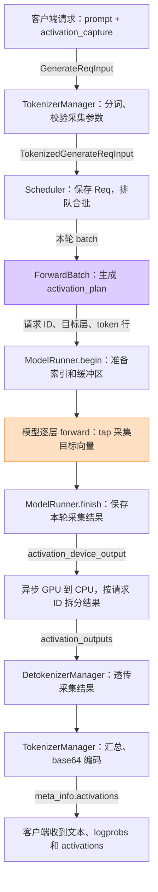

# SGLang 按请求提取隐藏层的实现说明

这次给 SGLang 增加了一个 `activation_capture` 参数。请求可以指定层号、层内位置和 token 范围，在拿到模型回复的同时拿到对应的完整隐藏向量。不同请求可以选不同的层，不需要重启服务，也不需要重新加载模型。

代码基于官方 **SGLang 0.5.19 wheel**，固定了版本和文件哈希。修改放在独立的 `sglang-activation-runtime` 目录里：对官方源码的改动保存在补丁中，采集逻辑放在新增模块中，运行时加载独立的源码副本。原来的 SGLang 安装和 `sglang_fe`、`sglang_det` 提取方案保留。

下面的实现和测试记录对应 2026 年 10 月 12 日这一版。

## 请求怎么写

服务启动前需要设置 `SGLANG_ACTIVATION_CAPTURE=1`，当前影子模型的启动脚本已经设置。原生 `/generate` 请求可以这样传：

```json
{
  "text": "请介绍一下这段代码的作用。",
  "sampling_params": {"max_new_tokens": 32, "temperature": 0},
  "activation_capture": {
    "targets": [
      {"layer": 9, "site": "block_output"},
      {"layer": 19, "site": "ffn_output"}
    ],
    "tokens": {"prompt": "last", "generated": "none"},
    "encoding": "base64"
  }
}
```

层号从 0 开始，`9` 表示第十个 decoder block。上面的请求会取两个向量；下一次换层，只需要改 `targets`。

`site` 目前支持两个位置：

| 参数值 | 取到的内容 |
| --- | --- |
| `ffn_output` | FFN 分支输出，已经完成必要的跨卡通信，还没有加回残差 |
| `block_output` | FFN 输出加回残差后的 block 输出，模型最后一层也取最终 RMSNorm 之前的值 |

`tokens.prompt` 可以是 `last`、`all`、`none`，也可以是 `[0, 15, 31]` 这样的绝对 token 位置列表。位置按分词后的完整输入计算，包含聊天模板和特殊 token。`tokens.generated` 默认是 `none`；需要生成过程中的状态时用 `processed`，具体对齐规则见后文。

原生接口把结果放在 `meta_info.activations.chunks`。每个 chunk 带有层号、采集位置、token 位置、token ID、形状、dtype 和数据，形状为 `[token 数量, hidden_size]`。`base64` 编码的是模型 dtype 的原始字节，不会把 BF16 向量压成低精度摘要。需要逐项查看时可以用 `float_list`，但大结果不适合这种编码。

同一个参数也接到了 `Engine.generate()`、`Engine.async_generate()` 和两个 OpenAI 接口。OpenAI SDK 可以通过 `extra_body` 传入，非流式结果位于 `choices[i].activations`。批量 Engine 请求可以给每个样本传不同的配置，其中 `None` 表示不采集。

## 请求在 SGLang 里怎么传

这一版没有改 SGLang 的请求调度方式。采集配置跟着正常请求进入 scheduler，模型照常做连续批处理。



图中画的是采集相关的主路径，返回字段按原生 `/generate` 接口标注。长 prompt 分块处理或生成多个 token 时，Scheduler 会逐轮安排计算，`activation_plan` 也逐轮更新。非流式请求到结束时统一返回向量，流式请求按增量返回。

具体经过五个位置：

1. **请求入口。** `GenerateReqInput` 和 OpenAI 请求结构增加 `activation_capture`。TokenizerManager 在拿到实际 token 数后校验层号、位置、输出预算，并把配置传给 `TokenizedGenerateReqInput`。
2. **调度器。** Scheduler 创建 `Req` 时保留这份配置。请求排队、合批后，`ForwardBatch` 根据本轮真正参与计算的 token 构造 `activation_plan`。
3. **模型执行。** `ModelRunner.forward()` 在执行前调用 `begin()` 准备缓冲区和采集索引，在执行后调用 `finish()` 取出这一轮的结果。模型逐层循环中放置明确的 `tap()` 调用。
4. **GPU 到 CPU。** 采集结果进入 `LogitsProcessorOutput.activation_device_output`，再交给现有 generation result 的异步拷贝逻辑。
5. **响应。** Scheduler 按请求拆分结果，经 DetokenizerManager 透传给 TokenizerManager，最后编码进 HTTP 或 Engine 返回值。

这里新增了独立字段，没有改 `return_hidden_states` 的含义，也没有借用 EAGLE 的内部状态。实现时还遇到一个具体问题：`ModelRunner.sample()` 会清空原有的 `auxiliary_device_output`。如果直接把采集结果放进去，到了采样阶段就会丢失。因此先用 `activation_device_output` 保存，在 D2H 拷贝阶段再与原有辅助输出合并。

## 模型层内到底取什么

SGLang 的实现需要结合残差处理来看。Qwen3 的模型循环继承自 `Qwen2Model`，所以 Qwen3 的采集入口实际加在 `models/qwen2.py`；Llama 和 Qwen3.5 也在各自的逐层循环中加了同样的调用。

这些层的返回值把 `hidden_states` 和 `residual` 分开保存。在当前适配的位置，两种输出对应：

```python
ffn_output = hidden_states
block_output = hidden_states + residual
```

如果 `residual` 为空，直接使用 `hidden_states`。只取返回值的第一项，会把 FFN 分支误当成完整 block 输出，送给按 residual 训练的 probe 就不对了。

多卡下还要保证 FFN 的通信已经完成。原实现允许把 MLP 的 all-reduce 延迟到下一层，与后续操作融合。开启采集后，这条延迟融合路径会被关闭，保证取到的是完整 FFN 输出。所有 TP rank 仍参与模型计算和通信，只有 rank 0 收集、回传向量。

因此，这项改动并不只是增加几个返回字段。采集位置也约束了某些计算融合，不能把所有原有优化都原封不动保留下来。

## 并发时怎么采集

### Prefill 只复制需要的 token 行

Prefill 是处理输入 prompt 的阶段。SGLang 会把不同请求本轮要计算的 token 拼进一个 batch，采集逻辑必须把这些行映射回原请求。

`activation_plan` 记录请求 ID、采集配置、当前 batch 内的起始行，以及本轮对应的绝对 token 位置。计算行偏移时，不采集的请求也必须算进去。例如某次 prefill 中 A、B、C 分别占 5、4、3 行，A 和 C 要取本轮最后一个 token，那么应读取第 4、11 行，不能因为 B 不采集就跳过它的行数。

准备好索引后，按目标层归组，每个被选中的层调用一个 Triton kernel，完成选行、按需加残差和复制。只需要最后一个 token 时，GPU 输出缓冲区里就只放这些选中的向量，不会先保存整段 prompt 的所有隐藏状态。

有实际采集行的 prefill batch 目前使用 eager forward，批处理和 chunked prefill 仍然保留。没有采集行的 batch 可以继续使用官方 prefill graph；GPU7 的这次部署则显式关闭了 prefill graph。

### Decode 通过 GPU 索引表换层

Decode 是逐 token 生成阶段。CUDA Graph 会复用捕获时的执行过程，不能靠每次修改 Python 层的分支来动态选择采集层。

因此，decode graph 里每层都放了一个采集 kernel，并预先分配固定地址的选择表和输出缓冲区。选择表的形状是：

```text
[模型层数, 2 种采集位置, batch 容量]
```

表项记录当前行要写到哪个输出位置，`-1` 表示不用采集。每次 forward 前，根据本批请求更新表的内容。今天取第十层、下一次取第二十层，改变的是表项，不需要重新捕获 graph。两个并发请求选择不同层或不同 site，也按各自的表项处理。

未选中的层只检查表项，不读取整个隐藏向量。不过，检查 kernel 仍然存在，所以开启采集能力的 decode graph 有固定开销。普通 chat 实例关闭采集开关，避免承担这部分开销。

### 回传前先保存本轮结果

Decode 的输出缓冲区会被下一次 graph replay 复用。异步回传如果直接引用这块缓冲区，下一轮计算可能覆盖尚未拷完的数据。

`Recorder.finish()` 因此先在 forward stream 上复制一份本轮有效结果，再通过 SGLang 已有的 pinned-memory D2H、`record_stream` 和完成事件传回 CPU。采集过程中没有在每层调用 `.cpu()` 或 `.tolist()`。

CPU 侧根据 segment 中的请求 ID 和输出范围拆分数据。已经完成的 token 以外的行会被过滤；请求重算产生的重复位置按目标和 token 位置去重。结果消费完后，释放本轮的索引和输出引用，避免一直留着上一轮的大块 prefill 缓冲区。

## 缓存和 token 对齐

Prefix cache 只保存推理需要的 KV，并不保存用户这次想要的任意中间层向量。如果目标 token 完全命中缓存、没有重新执行 forward，就没有新向量可以返回。

这次在 `Req` 匹配前缀缓存时加了 `prefix_limit()`：缓存最多复用到最早尚未采集的目标 token 之前。取 prompt 最后一个 token 时，前面的缓存通常仍可复用；取整个 prompt 时，通常需要重算整段输入。Chunked prefill 则只在包含目标位置的那一轮采集，再把各轮结果汇总。

生成 token 的隐藏状态按**作为模型输入的位置**对齐。例如 prompt 的最后一个位置用于预测第一个生成 token，但它仍然是 prompt 的状态。第一个生成 token 要等下一轮作为输入计算后，才有自己的状态。

所以 `generated: processed` 只返回真正执行过 forward 的生成 token。正常生成结束时，最后一个输出 token 往往还没有再次送进模型，这个 token 的状态就不会返回。实现没有为了补它而额外执行一次 forward。

流式响应发送新增 chunks，客户端按层、site 和 token 位置汇总。非流式响应先累积原始字节，等请求结束才统一做 base64 编码，避免生成过程中反复序列化历史结果。

## 怎么接到现有 probe

SGLang 的采集接口本身不知道 probe 用哪几层。业务侧新增了 `backend/activation_probe_server.py`，读取已有 checkpoint 的提取定义，再生成 `activation_capture` 请求。

目前三个 probe 的配置是：

| Probe | 0-based 层号 | 按第 1 层起算 | 分类器 |
| --- | ---: | ---: | --- |
| 内容安全 | 21 | 第 22 层 | 小型 MLP |
| 提示词泄露 | 14 | 第 15 层 | 小型 MLP |
| 间接提示注入 | 22 | 第 23 层 | 线性分类器 |

三者都取完整 prompt 最后一个 token 的 `block_output`，每层 4096 维。影子模型的 prompt 按训练约定使用 `add_generation_prompt=True` 和 `enable_thinking=True`，包含系统提示、对话和工具上下文。这与业务 chat 是否向用户展示思考过程是分别配置的。

一次检测把三个 target 一起交给影子模型，不会为每个 probe 单独跑一次大模型。当前请求仍使用正常生成入口，设置 `max_new_tokens=1`；分类只消费 prompt 向量，不使用这个生成 token。

**影子模型在 GPU 上提取向量，probe 权重和分类计算在 CPU 上。** CPU 服务解码 BF16 数据后，检查层号、site、token ID、位置、形状和有限值，再按 checkpoint 做标准化、分类和阈值判断。它不使用旧的 forward hooks、npz 中转文件或额外的 flush 请求。并发 HTTP 请求直接交给 SGLang 合批。

2026 年 10 月 12 日的部署中，chat 和影子模型各占 GPU7 约 34 GiB，probe API 不占用 GPU。端口分别是 chat `8104`、影子模型 `8303`、probe API `8302`，前端继续使用 `18088`。已有前端通过兼容的 `/detect`、`/bank` 和 `/v1/models` 接口接入。

## 验证结果和实际限制

测试中发现，普通 BF16 推理会随批次大小产生数值波动，近阈值的 probe 甚至可能改变判定。部署时只给影子模型开启 SGLang 自带的 `--enable-deterministic-inference`，chat 保持正常配置。确定性模式也有计算成本，下面的并发耗时已经包含它。

同一张 H20-3e 上，测试同时运行两路 chat 生成和多路 probe 请求，结果如下：

| Probe 并发数 | Probe 请求中位耗时 | 与单请求的最大概率差 |
| ---: | ---: | ---: |
| 1 | 51 ms | 0 |
| 8 | 96 ms | 0 |
| 16 | 134 ms | 0 |
| 32 | 157 ms | 0 |

这些是短提示词测试中的观测值，不能直接当作长上下文或持续高负载下的延迟承诺。测试还覆盖了同批请求选择不同层和 site、decode CUDA Graph 回放、4958-token 分块预填充及缓存复用。

真实 Qwen3-8B 用三个输入、每个输入三层向量，对照 Hugging Face BF16 输出：最低余弦相似度约 0.9995，最大相对 L2 误差约 3.15%，probe 概率差最大约 0.020，三个输入的判定一致。这说明采集位置和数值基本对齐，不代表两个推理引擎逐位一致。更早的小模型测试还覆盖了 Qwen3、Llama、Qwen3.5 Dense，以及 Qwen3 的 TP=2。

完整向量的传输成本仍然存在。比如 4096 个 token、两个目标层、4096 维 BF16，原始输出就是 64 MiB，base64 后还会增加约三分之一。当前三个 probe 只取最后一个 token，原始向量合计 24 KiB。并发场景下，这个范围选择比编码上的小优化更影响成本。

接口默认限制每请求最多 8 个 target，原始输出预算为 128 MiB，并按 FP32 大小保守估算。超限请求会被拒绝；这个限制不等于最终 JSON 或整个服务的内存上限。

模型适配目前包含 Qwen2/Qwen3、Llama 和 Qwen3.5 Dense；Qwen2 复用入口，但没有单独完成一套模型参考测试。Qwen3.5 MoE 的数值对照尚未解决，启动时明确拒绝。Speculative decoding、PP、DP attention、context/sequence parallel、two-batch-overlap、PD 分离、session、beam search 和多模态输入也未开放。不能把当前结果推到所有 SGLang 模型和执行配置。

前端真实测试已走通聊天、工具调用和每轮上下文检测。两个 HR 注入案例在注入送达后被拦截，但现有 probe 也会误报正常 HR 指令；另一个正常案例给出了文字结论，却没有调用保存工具。原权重和阈值没有改动，这些现象记录在部署报告里，不能用“链路跑通”代替对分类效果的评估。

## 代码位置和后续维护

采集逻辑主要在三个新增文件中，以下路径相对于 `sglang-activation-runtime/`：

| 文件 | 内容 |
| --- | --- |
| `src/sglang/srt/activation_capture/spec.py` | 请求校验、token 选择、前缀缓存限制 |
| `src/sglang/srt/activation_capture/runtime.py` | 每轮采集计划、缓冲区、结果拆分和编码 |
| `src/sglang/srt/activation_capture/kernels.py` | Prefill 和 decode 的 Triton 采集 kernel |

对官方源码的修改集中在 18 个文件，完整 diff 见 [activation-capture.patch](../../sglang-activation-runtime/patches/activation-capture.patch)。下面的路径均以 `sglang/srt/` 为起点：

| 位置 | 改动 |
| --- | --- |
| `entrypoints/engine.py`、`entrypoints/openai/` | 接收采集参数，向响应中加入结果 |
| `managers/io_struct.py`、`tokenizer_manager.py`、`schedule_batch.py`、`scheduler.py` | 请求参数传递、校验、缓存限制 |
| `model_executor/forward_batch_info.py`、`model_runner.py` | 创建本轮采集计划，衔接 forward 和 graph |
| `models/qwen2.py`、`models/llama.py`、`models/qwen3_5.py` | 在模型层循环中调用采集入口 |
| `layers/communicator.py`、`layers/logits_processor.py` | 保证通信完成，增加独立设备输出字段 |
| `managers/utils.py`、`managers/scheduler_components/output_streamer.py`、`managers/detokenizer_manager.py` | 异步 D2H、按请求拆分和进程间传递 |

平时换层或换 token 范围只改请求参数；增加新的层内位置或模型架构，则要补模型采集入口并重新做数值对照。Probe 服务仍受 checkpoint 的训练定义约束，不能把一个按第 21 层训练的分类器直接接到第 20 层上。

维护源码时要注意：运行目录中的 `.source/` 是本机副本，不纳入版本管理。新增模块以 `src/` 为准，调试前同步到 `.source/sglang/srt/activation_capture/`；对官方文件的修改用 `tools/export_patch.py` 导出。`tools/bootstrap.py` 会校验 [upstream.json](../../sglang-activation-runtime/upstream.json) 中的 wheel 哈希，然后在全新目录提取源码、应用补丁，已有 `.source/` 不会被覆盖。

接口用法见 [README](../../sglang-activation-runtime/README.md)，启动命令和服务配置见 [部署说明](../../sglang-activation-runtime/deploy/README.md)，本次实际模型与前端验证结果见 [GPU7 测试记录](../../sglang-activation-runtime/deploy/validation-gpu7.json)。
