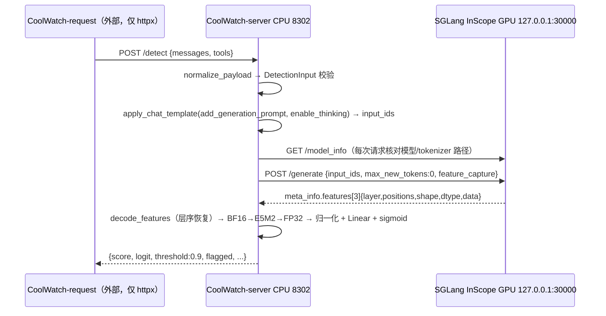

# CoolWatch 双端口 / server-client 拆分设计

状态：**设计稿，未实施**。本文只描述目标结构、边界与迁移步骤，不代表代码已改动。
依据：2026-10-22 对 h20-1 `/mnt/kpfs_qyang/yutongz/CoolWatch-server` 与同级 `CoolWatch-request` 的只读核查。
参照：vLLM V1 的进程边界（API Server 进程 ↔ ZMQ ↔ EngineCore ↔ GPU Worker，见 <https://docs.vllm.ai/en/latest/design/arch_overview.html>）。

---

## 1. 结论摘要

1. **双端已经是分开的，不需要「拆开」**：CPU 侧 `8302`（FastAPI/tokenizer/A6 probe）与 GPU 侧 `127.0.0.1:30000`（SGLang InScope）是两个进程、两个端口、两把 key。
2. **真正混在一起的是三处边界**：venv 混装两端且 editable 装了客户端、模型身份校验职责错位、GPU 特征以 JSON `float_list` 承载。
3. 推荐 **方案 A：保持双进程双端口，把耦合抽成协议**；不推荐自建 ZMQ engine（方案 B），因为该服务无 decode、无流式、无连续批处理调度需求。
4. 拆分时必须保持的数值契约见 §6；任何一条改动都要重做 GPU 对照。
5. 至少需要一次**停服 + 重启 + GPU 验收**：`8302` 侧模块重构需重启进程（当前进程加载的模块无法热替换），`30000` 侧编码格式变更需重启 SGLang。

---

## 2. 现状（只读核查）

### 2.1 进程与端口

| 端口 | 绑定 | 进程 | 角色 | 加载 |
| --- | --- | --- | --- | --- |
| `8302` | `0.0.0.0`（公网 `110.43.164.178` → 宿主机 `10.0.2.5`） | PID 3868396 → 3868397 `uvicorn shadow_server.app:create_app --factory` | CPU 侧 API | tokenizer + A6 probe（torch CPU）+ httpx 后端客户端 |
| `30000` | `127.0.0.1` | PID 3868386 → 3868387 `sglang.launch_server`，scheduler 3870452 | GPU 侧影子模型 | Qwen3-8B-FP8，prefill + 按请求抓层 |

- 两者均由 `scripts/service.py` 以脱离 SSH 会话的后台进程方式管理（状态 `.runtime/{backend,api}.json`，日志 `logs/`），**未配置开机自启**。
- 公网 `110.43.164.178` **不在这台机器的网卡上**（本机地址为 `10.0.2.5/10.248.*/10.174.*/172.17.0.1`）：对公网地址发起请求时，本机建立的连接是 `10.0.2.5:8302 ↔ 10.0.2.5:59230`，即出口被平台 NAT 回环回本机。8302 本身遵循文档监听 `0.0.0.0`，从外部机器（非本机）可直接改造。

### 2.2 请求链路（现状）



### 2.3 源码职责

| 文件 | 职责 | 评价 |
| --- | --- | --- |
| `shadow_server/app.py` | 路由、鉴权、限流、超时、生命周期 | 边界清晰 |
| `shadow_server/normalization.py` | 输入格式保守规范化 | 边界清晰，纯 CPU |
| `shadow_server/rendering.py` | developer→system 适配、工具参数、模板与分词 | 依赖 tokenizer（CPU） |
| `shadow_server/backend.py` | 后端身份检查 + 原生 HTTP 协议 + 严格特征校验 | **混合三职责** |
| `shadow_server/probe.py` | checkpoint 校验、E5M2 量化、归一化、线性打分 | 边界清晰 |
| `shadow_server/config.py` | 环境配置 + 固定 commit/哈希 + FP8 模型检查 | 常量散落处之一 |

### 2.4 核查到的耦合点（证据）

1. **venv 混装**：`CoolWatch-server/.venv/lib/python3.12/site-packages/` 同时含 `coolwatch_request-0.1.0.dist-info`、`__editable__.coolwatch_request-0.1.0.pth`（指向 `/mnt/kpfs_qyang/yutongz/CoolWatch-request`）与 `coolwatch_server-0.2.0.dist-info`；`.venv/bin/python -c "import coolwatch_request"` 成功。即**服务端环境里装着客户端**。
2. **`.venv` 借系统环境**：`pyvenv.cfg` 为 `include-system-site-packages = true`，`home = /opt/miniconda3/envs/inscope/bin`；`.venv` 自身仅 12 MB，torch/sglang 实际来自 `/opt/miniconda3/envs/inscope`（server venv 能 import torch/transformers/fastapi/uvicorn/sglang）。
3. **`PYTHONPATH` 合并**：`scripts/common.sh` 设置 `PYTHONPATH="$PROJECT_ROOT:..."`，启动脚本靠它找到 `shadow_server`。
4. **模型身份校验职责错位**：`backend.py:49-60` 在 CPU 进程里解析 GPU 侧的 `/model_info` 并比对路径。
5. **传输格式**：`backend.py:61-67` 请求 `encoding: "float_list"`，49152 个 float 以 JSON 文本返回。
6. **常量重复**：`INSCOPE_COMMIT`/`CHECKPOINT_SHA256` 在 `config.py:8-9`，层号/位置/`input_dim` 在 `probe.py:10-14`，`validate_model` 在 `config.py:53-66`；`scripts/start_backend.sh` 又独立校验一次 commit 与 import 路径。
7. **历史参照**：旧项目 `CoolWatch/sglang-activation-runtime` 已有同构部署（`8104` chat + `8303` shadow 模型 + `8302` CPU probe，probe 以 `--upstream http://127.0.0.1:8303` 访问影子模型）。当前 CoolWatch-server 是该结构的等价重写。

### 2.5 与 vLLM 的对照

| 层 | vLLM V1 | CoolWatch 现状 |
| --- | --- | --- |
| 对外 HTTP / 输入处理 | API Server 进程（默认 1） | `uvicorn` 8302 ✅ |
| 调度 / 引擎核心 | EngineCore 进程（ZMQ，busy loop） | **无自建层**，调度交给 SGLang 内置 scheduler |
| GPU 执行 | GPU Worker（每卡 1 进程） | `sglang::scheduler` 子进程 ✅ |
| 进程间传输 | ZMQ / msgpack 对象 | HTTP + JSON（`float_list`） |
| 客户端 | OpenAI SDK | 独立 `coolwatch-request` 包 ✅（仅 httpx） |
| 进程数 | `A + DP + N` | 2（API + SGLang 进程组） |

结论：**「两进程 + 两端口 + 纯客户端包」的形状已与 vLLM 同构**，差距在传输层与职责划分，不在进程拓扑。

### 2.6 与远端同步状态

- 远端 `/mnt/kpfs_qyang/yutongz/CoolWatch-server` 是唯一版本；本地镜像此前为空。
- **CoolWatch-server 无 git 仓库**（只有 `.gitignore`）；旧 `CoolWatch` 是 git 仓库（origin `git@github.com:RebeccaZhang22/CoolWatch.git`，存在未提交改动），但**不包含** CoolWatch-server 任何文件。
- `vendor/sglang-inscope` HEAD = `d504843f44ae733e1970e70ab6bbbd9ab044e353`，与 `config.py:9` 一致。
- 服务于 `2026-10-21 18:50:12` 启动；之后仅文档、`.env.example`、`scripts/start_api.sh`、`__pycache__` 变更，`shadow_server/*.py` 全部早于启动 → **运行中代码与磁盘一致，无漂移**。

---

## 3. 目标结构（方案 A）

```text
┌── coolwatch-request ─────────────────────────────┐
│  pip 包，仅 httpx，任意可达机器（无 GPU/无 torch）│
│  CoolWatchClient / AsyncCoolWatchClient          │
│  → 只认 8302：/detect /info /health/*            │
└────────────────────┬─────────────────────────────┘
                     │ HTTP（公网，Bearer SHADOW_API_KEY）
┌────────────────────▼─────────────────────────────┐
│ coolwatch-server（CPU，8302，无 GPU 依赖）        │
│  normalize → render(+template_version)           │
│  → shadow client（新包，封装 capture 协议）       │
│  → probe 打分（A6，固定 0.9）                     │
└────────────────────┬─────────────────────────────┘
                     │ POST /capture（127.0.0.1:30000，Bearer SGLANG_API_KEY）
┌────────────────────▼─────────────────────────────┐
│ coolwatch-shadow（GPU，30000）                    │
│  SGLang InScope；自己校验模型身份                 │
│  出参固定 [1,3,4,4096]（或 49152），E5M2/BF16     │
└──────────────────────────────────────────────────┘
```

设计原则：**协议优先于进程**。先让每个包只依赖「契约包 + 一个传输客户端」，再谈是否合并 CLI。

### 3.1 目标包划分

| 包 | 内容 | 依赖 | 运行位置 |
| --- | --- | --- | --- |
| `coolwatch-contract` | 常量 + pydantic schema：`INSCOPE_COMMIT`、`CHECKPOINT_SHA256`、`block_indices`、`capture_layers`、`selected_positions`、`input_dim`、`flatten_order`、`template_version`、capture 请求/响应模型 | pydantic（或纯 dataclass） | 三端共享 |
| `coolwatch-server` | `app.py`、`normalization.py`、`rendering.py`、`probe.py`、`shadow_client.py` | contract + fastapi + torch(CPU) + transformers + httpx | CPU 8302 |
| `coolwatch-shadow-service` | SGLang 启动器 + 身份校验 + capture 端点/适配 | contract + sglang（`/opt/miniconda3/envs/inscope`） | GPU 30000 |
| `coolwatch-request` | 现有客户端（保持 `/detect` 协议） | contract（可选）+ httpx | 任意机器 |

同一仓库多 entrypoint 亦可（vLLM 即单仓多 entrypoint）：`coolwatch serve --api|--shadow`，由 `scripts/service.py` 分别拉起。

### 3.2 职责重划

`backend.py` 现在混了三件事，拆分后：

| 原职责 | 去向 |
| --- | --- |
| 构造 `/generate` + `feature_capture` 请求 | `coolwatch-contract` 的请求模型 + server 的 `shadow_client` |
| 解析并严格校验特征（schema/层/位置/形状/有限性/层序恢复） | server 侧保留（**消费方校验不能下放**） |
| 解析 `/model_info` 并比对模型路径 | 下移到 shadow 服务**启动时**校验一次；capture 响应带 `model_id`/`model_revision`，server 只比对标识而非路径 |

### 3.3 传输格式（可选优化，独立于拆分）

实测（`/tmp/bench_feat.py`，49152 个 bf16 取整值，单进程）：

| 格式 | 载荷 | 序列化 | 反序列化 |
| --- | --- | --- | --- |
| `float_list`（现状） | 575 KiB | 14.0 ms `json.dumps` | 6.1 ms `json.loads` |
| `base64` + raw bf16 | 96 KiB → base64 128 KiB | — | — |
| `base64` + raw e5m2 | 48 KiB → base64 64 KiB | — | b64+decode+cast 0.44 ms |

即 text 约 4.5–9× 体积；base64 往返几乎免费。建议：
- contract 增加 `encoding: "base64"` + `dtype: "e5m2"|"bfloat16"`，**默认仍为 `float_list`**以保证兼容；
- shadow 侧先支持新编码，server 侧切换开关（环境变量），一次一步；
- 若 shadow 直接给 **FP8 E5M2**，server 可跳过 §6 的 `BF16→E5M2` 一步，但必须证明数值等价（见 §7），否则不要省。

---

## 4. 不推荐的方案 B

方案 B：自建 EngineCore（自定义 ZMQ/msgpack 或共享内存环形缓冲，把 serve 塞进引擎、绕开 HTTP）。

- 该服务一路只有 **prefill + 固定 4 个位置 + 无 decode、无流式、无采样**，ZMQ 的收益（流式 token、连续批处理调度、请求生命周期管理）在这里用不上。
- 代价是把 fork 的 SGLang 启动/生命周期/显存管理搬进自定义引擎，且运维脚本要重建。
- 结论：**不推荐**。传输层若确要提速，走 §3.3 的 base64，而不是换协议栈。

---

## 5. 迁移步骤（可回滚，逐个提交）

前置：给 CoolWatch-server 建 git 基线（见 §8），确认重启窗口与 GPU 可用。

| 步骤 | 内容 | 需重启 | 风险 |
| --- | --- | --- | --- |
| S0 | git 基线：`.gitignore` 补齐（`.venv/ vendor/ logs/ .runtime/ .env` 已在），首次提交为「现状存档」 | 否 | 无 |
| S1 | 抽出 `coolwatch-contract`，只放常量与 schema；三端改为 import 它。**行为零变化** | 是（server） | 低；必须逐项核对常量值 |
| S2 | 拆 `backend.py`：身份校验下移到 shadow 启动时；server 只比对 `model_id`；特征校验留在 server | 是 | 中；身份校验放宽处需要测试覆盖 |
| S3 | venv 分家：server 只装 CPU 依赖，移除 `coolwatch_request` editable；`PYTHONPATH` 收紧为只含本项目 | 是 | 低 |
| S4 | 传输：contract 加 `base64`，shadow 先支持，server 用开关切换并保留 `float_list` 回退 | 是（两端） | 中；需数值对照 |
| S5 | CLI 统一为 `coolwatch serve --api\|--shadow`，`scripts/service.py` 改为调用它 | 是 | 低 |
| S6 | （可选）systemd unit 替代脱离会话的后台进程，补开机自启 | 是 | 低；旧项目 `deploy/systemd/` 有可复用模板 |

每步之后的最小验收：

```bash
# CPU 契约（不需 GPU）
.venv/bin/python -m unittest discover -s tests -v
# 真实 GPU（需重启后）
set -a; source .env; set +a
python scripts/smoke.py --url http://127.0.0.1:8302
# 固定输入数值对照（拆分前后各跑一次，逐位比较 score/logit）
```

---

## 6. 不可动的数值契约（红线）

| 项目 | 值 | 出处 |
| --- | --- | --- |
| 源 decoder block | `[8, 16, 24]` | `probe.py` / manifest |
| 本 InScope 请求层号 | `[9, 17, 25]`（源层 +1，block boundary 编号、embedding=0） | `probe.py`、开发者指南 §层号映射证据 |
| 位置 | `[-4, -3, -2, -1]`，**完整模板（含 generation prompt）**的最后四个 token | `backend.py:65` |
| 模板 | `add_generation_prompt=True, enable_thinking=True`，保留 CoT、无 question prefix | `rendering.py` |
| 特征形状 / 展平 | `[1,3,4,4096]` → `[1,49152]`，顺序 **layer → token → hidden** | `probe.py:60` |
| 量化链 | 原采集 BF16 → 存储/打分 E5M2 → FP32（**与权重量化 E4M3 不同，不可混用或省略**） | `probe.py:59-60` |
| 归一化 | checkpoint 静态 `input_mean/input_std`，**不按请求动态估计** | `probe.py:68` |
| 阈值 | 固定 `0.9`，不按请求/来源切换 | `config.py:32` |
| checkpoint SHA256 | `10f79d9c7acab62a1640e1397449f47e8bf392bb6b8c9bc0b55f67274cb2e3e0` | `config.py:8` |
| InScope commit | `d504843f44ae733e1970e70ab6bbbd9ab044e353` | `config.py:9` |
| 打分语义 | `flagged = score >= threshold`；失败**不得**返回 `flagged=false` | `app.py`、接口文档 |

---

## 7. 验收与风险

**必须重启的客观原因**：当前 `8302` 进程已加载 `shadow_server.*` 模块，Python 无法热替换已导入模块；`30000` 侧若改编码格式同样需重启。故 S1/S2/S3/S4/S5 均要求一次「停 → 起 → 验收」。

**验收矩阵**（每条都要在拆分前后各跑一次并记录）：

| 项 | 方法 | 通过标准 |
| --- | --- | --- |
| CPU 契约 | `unittest discover -s tests`（server 与 request 两侧） | 全绿，含真实 A6 checkpoint 与真实 E5M2 转换 |
| 数值一致性 | 固定 `examples/probe_request.json` + 9K/40K 长输入 | `score`/`logit` 与拆分前**逐位一致** |
| 公网链路 | 从外部机器 `curl http://110.43.164.178:8302/detect` | 200 且字段完整 |
| 并发/限流 | `MAX_INFLIGHT` 边界 | 超额仍按协议返回 429 |
| 失败语义 | 停 shadow 后调 `/detect` | 503/504，**不出现** 200 + `flagged=false` |
| 身份校验 | 指向不同模型路径启动 shadow | 启动即失败或 capture 拒绝 |

**已知未完成项（勿在拆分中被误当成已完成）**：

- `/info.fp8_probe_calibration = source_A6_validated_runtime_parity_pending`：源 h20-2 与当前 SGLang 运行时的**特征数值对照尚未完成**；历史 A6 指标不等于本运行时已复现。
- 线上任务效果评估未完成。
- 本机 GPU 7 上 CoolWatch 占约 30.2 GiB / 143.8 GiB（约 21%），其余 GPU 0–6 被同机其他用户项目占满（`ipi-doom` 等）；重启前需确认显存与邻居影响。

---

## 8. 建议的 git 基线与文件归属

CoolWatch-server 当前**无版本控制**，这是拆分前最大的工程风险。

```bash
cd /mnt/kpfs_qyang/yutongz/CoolWatch-server
git init
# .gitignore 已有：.venv/ __pycache__/ *.egg-info/ .env vendor/ models/ logs/ .runtime/
git add -A && git commit -m "chore: baseline of deployed CoolWatch-server (2026-10-21 18:50 runtime)"
```

注意：
- `vendor/sglang-inscope` 是独立 git 仓库且被 `.gitignore` 忽略（`vendor/`），保持为 submodule 或仅记录 commit（当前 `d504843…`）皆可，但**不要让两份 git 互相嵌套进索引**。
- `checkpoints/best_layers_08_16_24.pt` 仅 580 KiB，可入库或用 `manifest.json` 校验替代；当前 `.gitignore` 未忽略 `checkpoints/`。
- 与 request 的关系：目前是**两个平级目录、单向依赖**（request 不 import server，但其集成测试通过 `sys.path.insert` 引入 server 的 `create_app`）。若抽 contract 包，把该集成测试改为只依赖 contract + 模拟 shadow，可让两端测试彻底解耦。

---

## 9. 待确认问题

1. **8302 是否必须继续监听 `0.0.0.0`**：当前为公网直连；若改为「入口网关 + 内网 API」，则 8302 可退回 `127.0.0.1`，鉴权/限流/TLS 上移到网关。
2. **拆分范围**：只拆「包与依赖」（S1–S3），还是连传输格式一起改（S4）？后者可省约 80% 内部带宽但需数值对照。
3. **部署方式**：继续用 `scripts/service.py` 脱离会话后台进程，还是改用 systemd（旧 `CoolWatch/deploy/systemd/*.service` 可直接改造，且能解决当前「无开机自启」）。
4. **多租户/多风险**：当前只启用 `indirect_prompt_injection`；若后续要并发多探针（旧项目有 content safety / leakage），`/detect` 响应结构与 contract 需一次性规划（`per_risk` 结构）。